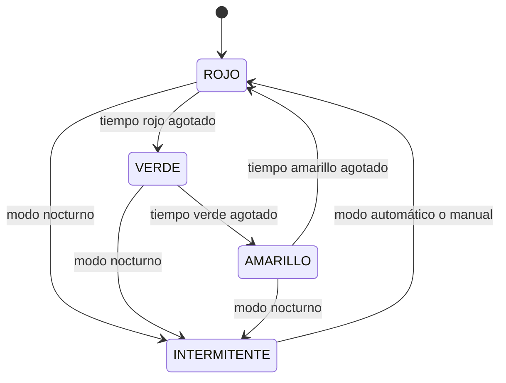

# 🚦 Simulador de Semáforo con Base de Datos

Aplicativo web que simula un semáforo vehicular y peatonal mediante una **máquina de estados finitos**, con tiempos configurables, modos de operación y una **base de datos local** que registra cada cambio de estado.

Proyecto del **Taller 4 – Retos y resolución de problemas** (nivel avanzado: pensamiento lógico y creatividad), Ingeniería de Software, Universidad Manuela Beltrán.

---

## Características

| ID | Requerimiento funcional | Descripción |
|----|-------------------------|-------------|
| RF1 | Ciclo automático | Rojo → Verde → Amarillo → Rojo con cuenta regresiva. El semáforo peatonal se sincroniza: verde solo con rojo vehicular y parpadeo en los últimos 3 s. |
| RF2 | Perfiles de tiempo (CRUD) | Crear, consultar, editar, activar y eliminar perfiles. Valida nombre único, rojo y verde de 5 a 120 s y amarillo de 3 a 6 s. |
| RF3 | Bitácora de eventos | Registra cada cambio de estado o de modo (fecha, estado anterior y nuevo, duración, modo y perfil), con filtros por estado y modo. |
| RF4 | Modos de operación | Automático, manual (paso a paso), intermitente nocturno y todo rojo de emergencia, más pausar, reanudar y reiniciar. |
| RF5 | Estadísticas y exportación | Ciclos completos, cambios de estado y tiempo acumulado por estado; exportación de la bitácora en CSV y de la base completa en JSON. |

Además:
- Velocidad de simulación x1, x2, x5 y x10 para demostraciones.
- Diseño adaptable a celular.
- Accesibilidad: el estado se indica con texto e íconos, no solo con color (WCAG 2.2, criterio 1.4.1).

## Ejecución

No requiere instalación, servidor ni dependencias.

```bash
git clone https://github.com/<usuario>/<repositorio>.git
cd <repositorio>
# Abrir semaforo.html en Chrome, Edge o Firefox
```

Para publicarlo con **GitHub Pages**: *Settings → Pages → Deploy from a branch → main / root* y abrir `https://<usuario>.github.io/<repositorio>/semaforo.html`.

## Estructura del proyecto

```
├── semaforo.html   # Aplicativo completo: HTML + CSS + JavaScript
└── README.md
```

Bloques principales dentro de `semaforo.html`:

| Líneas | Bloque |
|--------|--------|
| 8–169 | Estilos CSS (semáforo, interfaz y diseño adaptable) |
| 179–338 | Estructura HTML: pestañas Simulador, Perfiles, Bitácora y Estadísticas |
| 347–433 | Capa de datos: clase `BaseDatos` y datos semilla |
| 435–548 | Lógica: máquina de estados, temporizador y modos |
| 550–676 | Presentación: renderizado de luces, tablas e indicadores |
| 678–823 | Controladores: CRUD de perfiles, eventos de interfaz y exportación |

## Máquina de estados



Es una máquina tipo **Moore**: las luces dependen solo del estado actual, y el estado peatonal se deriva del vehicular, de modo que nunca coinciden los dos verdes.

## Modelo de datos

La base de datos se guarda en `localStorage` (clave `semaforo_bd_v1`). Si el almacenamiento está bloqueado, sigue funcionando en memoria.

| Tabla | Campos |
|-------|--------|
| `perfiles` | `id`, `nombre`, `rojo`, `verde`, `amarillo` |
| `eventos` | `id`, `fecha`, `tipo`, `anterior`, `nuevo`, `duracion`, `modo`, `perfil` |
| `config` | `perfilActivo` |

Operaciones de la clase `BaseDatos`: `insertar`, `seleccionar`, `buscarPorId`, `actualizar`, `eliminar` y `vaciar`, con IDs autoincrementales por tabla.

## Decisiones técnicas

- **Temporizador sin desfase:** cada tick de 100 ms descuenta el tiempo real transcurrido (marcas de tiempo), en lugar de suponer intervalos exactos de `setInterval`.
- **Amarillo de 3 a 6 s:** según la orientación del MUTCD (FHWA, 2023) para el intervalo de cambio.
- **Modo intermitente:** contemplado en el Manual de Señalización Vial de Colombia (Ministerio de Transporte, 2024).
- **JavaScript estándar (ECMAScript 2025):** sin librerías externas, en un solo archivo fácil de entregar y ejecutar.

## Pruebas

Se verificó con Playwright sobre Google Chrome:

- ✅ Transiciones en orden correcto durante varios ciclos
- ✅ La pausa congela el contador
- ✅ Modos manual, intermitente y todo rojo
- ✅ Validaciones del formulario (vacío, duplicado, amarillo fuera de rango)
- ✅ CRUD de perfiles y bloqueo del borrado del perfil activo
- ✅ Persistencia tras recargar la página
- ✅ Exportación CSV y JSON válida
- ✅ Sin errores de consola y sin desbordamiento en pantallas de 390 px

## Referencias

- Ecma International. (2025). *ECMAScript® 2025 language specification* (ECMA-262, 16.ª ed.). https://262.ecma-international.org/16.0/
- Federal Highway Administration. (2023). *Manual on uniform traffic control devices for streets and highways* (11.ª ed.). https://mutcd.fhwa.dot.gov/kno_11th_Edition.htm
- Kamput, A., Dechsupa, C., Vatanawood, W., & Pomsiri, S. (2024). Scalable timed-automata models for traffic light control systems. *IEEE Access, 12*, 124260–124281. https://doi.org/10.1109/ACCESS.2024.3455097
- Ministerio de Transporte. (2024). *Resolución 20243040045005 de 2024 – Manual de Señalización Vial de Colombia*.
- World Wide Web Consortium. (2024). *Web content accessibility guidelines (WCAG) 2.2*. https://www.w3.org/TR/WCAG22/

## Autor

**[Esteban Salvador Guzmán]** – Ingeniería de Software, Universidad Manuela Beltrán, Bogotá.
