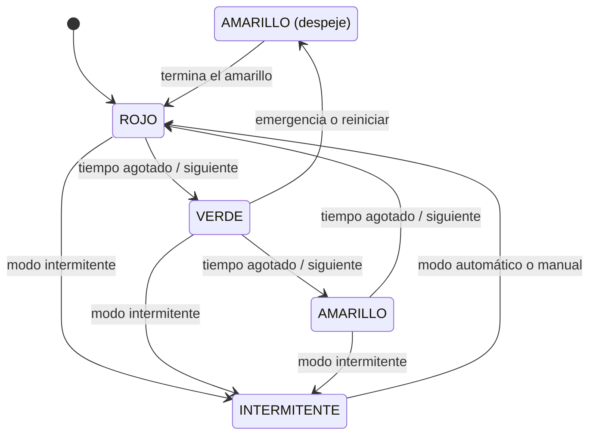

# 🚦 Simulador de Semáforo con Base de Datos · Versión 2 (corregida)

Segunda versión del aplicativo del **Taller 4 – Retos y resolución de problemas** (Ingeniería de Software, Universidad Manuela Beltrán).

Mantiene la misma interfaz de la versión 1 y corrige los hallazgos del documento de análisis y modelado: cuatro de diseño (H1–H4) y un error funcional (E3), el paso de verde a rojo sin amarillo.

---

## Cambios respecto a la versión 1

| ID | Versión 1 (sin corregir) | Versión 2 (corregida) |
|----|--------------------------|-----------------------|
| H1 | La bitácora guarda el **nombre** del perfil (dato desnormalizado). | Guarda `perfilId` como llave foránea; el nombre se consulta. No se puede eliminar un perfil que tenga eventos. |
| H2 | Estado global `sim` que cualquier función modifica. | Clase `Simulador` con campos privados (`#`), patrón **State** para los modos y **Observer** para la vista. |
| H3 | La bitácora crece sin límite y cada evento reescribe todo el JSON. | Máximo de **1000 eventos**; se descartan los más antiguos. |
| H4 | Sin aviso ni respaldo al abrir el archivo desde el disco. | Aviso de archivo local y botón **Importar JSON** con validación del archivo. |
| E3 | **Reiniciar** y **Emergencia** pasan de verde a rojo sin amarillo. | Si la vía está en verde, primero se cumple el amarillo completo y luego se aplica el rojo. |

En el código, cada cambio está marcado con un comentario `[H1]`…`[H4]` o `[E3]`; búscalo con `Ctrl + F` en VS Code.

## Requerimientos funcionales

| ID | Requerimiento | Descripción |
|----|---------------|-------------|
| RF1 | Ciclo automático | Rojo → Verde → Amarillo → Rojo con cuenta regresiva y semáforo peatonal sincronizado. |
| RF2 | Perfiles de tiempo (CRUD) | Crear, editar, activar y eliminar perfiles con validación de rangos e integridad referencial. |
| RF3 | Bitácora de eventos | Registro de cada cambio de estado o de modo, con filtros por estado y modo. |
| RF4 | Modos de operación | Automático, manual, intermitente y todo rojo de emergencia, más pausar y reiniciar. |
| RF5 | Estadísticas y exportación | Indicadores, exportación CSV/JSON e importación de respaldos JSON. |

## Ejecución

No requiere instalación ni servidor.

```bash
git clone https://github.com/Estebansalumb/Taller-4-Simulador-de-semaforo.git
cd Taller-4-Simulador-de-semaforo/version-2
# Abrir semaforo_v2.html en Chrome, Edge o Firefox
```

> La versión 2 usa su propia clave de almacenamiento (`semaforo_bd_v2`), así que no comparte datos con la versión 1.

## Estructura del archivo

| Líneas | Bloque |
|--------|--------|
| 7–170 | Estilos CSS |
| 179–340 | Estructura HTML: pestañas Simulador, Perfiles, Bitácora y Estadísticas |
| 345–449 | Capa de datos: clase `BaseDatos`, límite de bitácora e importación |
| 451–628 | Lógica: estrategias de modo (patrón State) y clase `Simulador` |
| 630–766 | Presentación: luces, contador, tablas e indicadores (observador) |
| 768–853 | Controlador de perfiles: validación, CRUD e integridad referencial |
| 855–931 | Controladores del simulador, bitácora, exportación e importación |
| 933–935 | Arranque |

## Máquina de estados



El despeje es un amarillo obligatorio con su duración completa. Mientras dura, la interfaz muestra "despeje en amarillo".

## Modelo de datos

Clave en `localStorage`: `semaforo_bd_v2`

| Tabla | Campos |
|-------|--------|
| `perfiles` | `id` (PK), `nombre` (único), `rojo`, `verde`, `amarillo` |
| `eventos` | `id` (PK), `fecha`, `tipo`, `anterior`, `nuevo`, `duracion`, `modo`, `perfilId` (FK → perfiles.id) |
| `config` | `perfilActivo` (FK → perfiles.id) |
| `secuencias` | último id de `perfiles` y `eventos` |

## Pruebas

Verificada con Playwright sobre Google Chrome: **24 de 24 pruebas aprobadas**.

- ✅ Regresión: ciclo en orden, modos, pausa, validaciones, persistencia y vista móvil
- ✅ [H1] Los eventos guardan `perfilId`; renombrar un perfil se refleja en la bitácora; no se elimina un perfil con eventos
- ✅ [H2] El estado del simulador no se puede modificar desde fuera de la clase
- ✅ [H3] La bitácora se limita a 1000 eventos
- ✅ [H4] Importa un respaldo válido, rechaza un JSON inválido y muestra el aviso de archivo local
- ✅ [E3] Emergencia y Reiniciar desde verde pasan por amarillo antes del rojo
- ✅ Sin errores de consola

## Estructura del repositorio

```
├── version-1/semaforo.html       # Versión original (sin corregir)
├── version-2/semaforo_v2.html    # Versión corregida
├── diagramas/                    # Diagramas UML en draw.io (.drawio) y PNG
└── README.md
```

## Autor

**[Esteban Salvador Guzmán]** – Ingeniería de Software, Universidad Manuela Beltrán, Bogotá.
